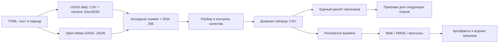
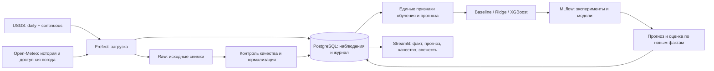

# Архитектура и временная постановка

## Работающий первый этап

Загрузка сохраняет исходные ответы, проверяет гидропост, параметры, статистику и единицы,
переводит футы в см, ft³/s в м³/s и объединяет источники по дате. Пропуски сохраняются
явно. Ошибочные значения, дубли дат и изменение схемы останавливают процесс.
Скачки уровня помечаются в отчёте; реальный паводок нельзя автоматически
удалять как выброс.

Baseline использует последнее известное наблюдение напрямую. Витрина
признаков строится тем же запуском, но обучаемые модели в текущем этапе
её ещё не используют. Повторная загрузка не создаёт дублей в итоговых CSV,
однако повторно запрашивает весь период. Инкрементальная загрузка пока
не реализована. Журнал содержит отдельные события начала и результата
каждого запуска; новый запуск закономерно создаёт новую запись журнала.

## Целевая архитектура

Технологии из аннотации вводятся на соответствующем этапе, когда можно
проверить их работу. В PostgreSQL планируются таблицы постов, наблюдений,
погоды, запусков и прогнозов. Ключ наблюдения должен включать источник,
пост, параметр, время и тип суточной статистики. Для исправленных значений
нужно хранить момент получения и исходный снимок.

## Защита от временной утечки

Строка с origin `t` описывает момент после получения суточного среднего
уровня USGS (`00065 / 00003`) за день `t`. Цель — уровень следующего дня. До проверки сроков публикации это
исследовательское допущение, а не подтверждённое время оперативного выпуска.

| Признак | Самые новые исходные данные |
| --- | --- |
| Текущий уровень | `t` |
| Лаг уровня 1, 2, 7 | `t−1`, `t−2`, `t−7` |
| Среднее уровня за 3 или 7 дней | `t` включительно |
| Изменение уровня | `t` и `t−1` |
| Архивная погода | `t−5` |
| Сумма осадков за 7 доступных дней | `t−11` … `t−5` |
| Календарные признаки | дата `t`, известна заранее |

Сначала восстанавливается календарная сетка, затем рассчитываются сдвиги.
`dropna` до `shift` запрещён: иначе вчерашняя строка может оказаться
позавчерашним измерением. `bfill` и интерполяция целевого уровня не применяются.
Признаки не содержат будущего target и не зависят от наличия будущих строк.
Это проверяется сравнением расчёта на полной и обрезанной истории.

## Валидация

Сейчас считается одношаговый baseline на последних 20% календарных дат
периода разработки 2008–2022. Данные 2023 года исключены из этих метрик
и зарезервированы для финальной оценки обученных моделей.
Дата разделения определяется до удаления неполных пар. Метрики сравнивают
прогноз, выпущенный из `t`, с фактом `t+1`; неизвестный будущий факт за
концом ряда не включается в число пропусков.

На этапе моделей: rolling-origin с расширяющимся обучающим окном, gap с
учётом горизонта, подбор гиперпараметров только внутри обучающего периода,
преобразования обучаются только на train. Модели сравниваются на одинаковых
датах. Отдельный финальный holdout не используется при выборе признаков,
моделей и параметров. Начальные baseline-метрики не заменяют этот эксперимент.

Пользовательская интерпретация MAE: средняя абсолютная ошибка в сантиметрах
на обозначенном периоде. RMSE сильнее учитывает крупные промахи. Для паводков
нужен отдельный анализ высоких уровней и резких подъёмов: малая средняя
ошибка сама по себе недостаточна для оценки полезности модели.
